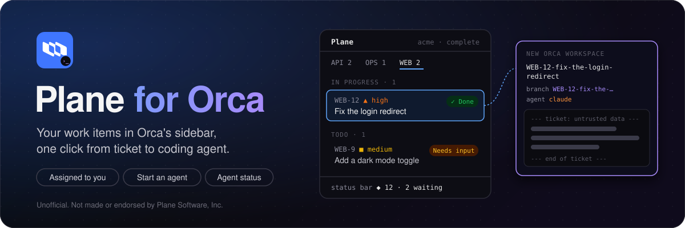
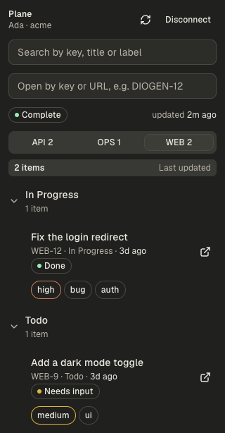
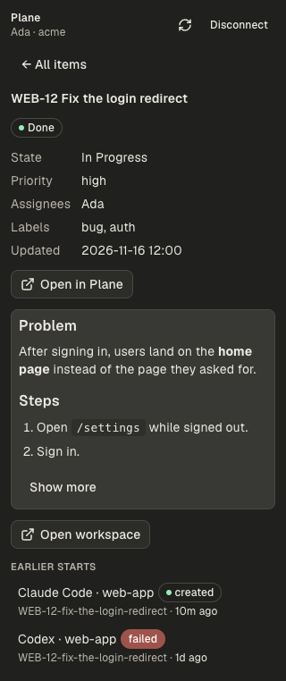
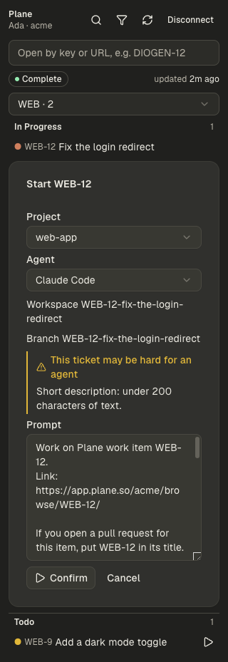
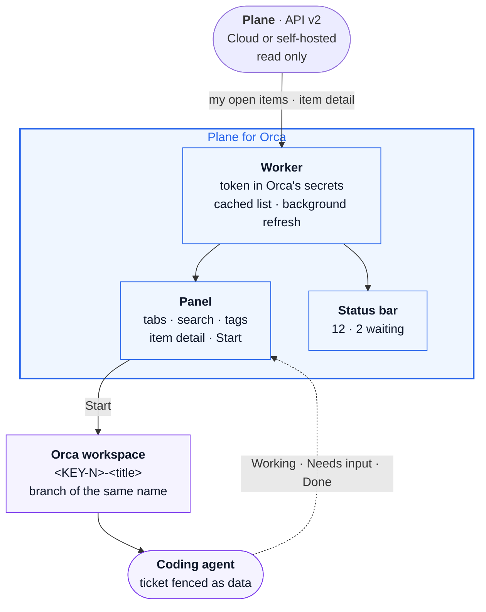

<p align="center">
  
</p>

<h3 align="center">Your Plane work items in Orca's sidebar, one click from ticket to coding agent</h3>

<p align="center">
  
  
  
  
  
  
</p>

<p align="center">
  <a href="#-recent-updates"><b>Recent updates</b></a> ·
  <a href="#-key-features"><b>Key features</b></a> ·
  <a href="#-quick-start"><b>Quick start</b></a> ·
  <a href="#-how-it-works"><b>How it works</b></a> ·
  <a href="openspec/specs/plane-work-items/spec.md"><b>Spec</b></a> ·
  <a href="#-read-next"><b>Read next</b></a>
</p>

<br>

Plane for Orca is an [Orca](https://orca.dev) plugin that shows the [Plane](https://plane.so) work
items assigned to you in Orca's right sidebar. **Start** on an item creates an Orca workspace on a
branch named after it and launches the coding agent you pick, with the ticket as context, fenced as
**untrusted data**. The panel then shows what that agent is doing, and the status bar tells you when
one waits for you. The plugin only **reads** Plane, and its token never reaches an agent. Not
affiliated with Plane.

<p align="center">
  
  &nbsp;
  
  &nbsp;
  
  <br>
  <sub>The Plane panel: your open items, one item with its agent and earlier Starts, and the Start confirmation.</sub>
</p>

## 📣 Recent updates

### 🔥 2026.11.19: Plane for Orca 0.1.0, the first release
- **Your open items in Orca**: the work items assigned to you in backlog, unstarted or started,
  one tab per Plane project, grouped by state, with search and tag filters. Open any other item of
  the workspace by its key or a pasted Plane URL.
- **From ticket to agent in one step**: Start creates the workspace and the branch `<KEY-N>-<title>`
  and launches the agent you pick among those installed (Claude Code, Codex, Gemini, OpenCode,
  Cursor) or a plain terminal. A prompt template
  setting puts your project's routine in front of the ticket.
- **Know where every agent is**: each started item shows Working, Needs input or Done; the status bar
  counts the agents that wait for you, and `Mod+Alt+J` takes you to the one that waited longest.
- **Upgrade note**: needs Orca 1.4.259 or newer and a Plane server with API v2 (Plane Cloud or a
  recent self-hosted Plane). The plugin never changes your work items; for agents that should,
  see [Let agents use Plane](#-let-agents-use-plane).

## 🚀 Key features

### 📋 Your open items, at a glance
> *What is assigned to you, in the sidebar next to your code, without opening Plane.*

* **One tab per project**: items are grouped by state (started, then unstarted, then backlog), newest
  update first, each with its key, priority and labels. Search filters by key, title or label;
  pressing a priority or label tag filters by it.
* **Honest about gaps**: the list says whether it is complete, partial (the item cap was reached or
  a page failed) or stale (the last refresh failed), and the status bar shows `?` instead of a
  wrong count.
* **Fast and gentle on Plane**: the panel shows the last known list at once and refreshes it in the
  background (every 10 minutes by default). On a rate limit it retries once, only for a wait of 30
  seconds or less.
* **Item detail**: state, priority, assignees, labels and the description (a long one folds), with a
  link to the item in Plane. **Open by key or URL** finds any item of the workspace, also one
  assigned to someone else or closed.

### 🤖 Start an agent on an item
> *One confirmation turns a ticket into a workspace, a branch and a running agent.*

* **Workspace and branch named after the item**: `<KEY-N>-<title>` in the Orca project you pick.
  The agent is asked to put the key in its pull request title, so Plane's Git integration links the
  branch and the PR to the item. An item that already has a workspace is not started twice.
* **The ticket is data, not instructions**: title, state, priority, labels, the parent's title and
  the description reach the agent inside a marked block that tells it so.
* **Your routine first**: the setting *Start prompt template* replaces the built-in instructions;
  `{key}`, `{url}` and `{ticket}` place the item, and the ticket block is always kept. You can still
  edit the prompt before each Start.
* **Readiness hints**: the confirmation warns when the description is empty or short, has no
  checklist, or has no code reference or link. Hints never block Start.

### 🧭 Follow the agents you started
> *The panel and the status bar tell you which agent needs you, and take you there.*

* **Agent state on the item**: Working, Needs input or Done, from the agent in the item's workspace.
* **Status bar**: your open items and the agents that wait (`12 · 2 waiting`); a click toggles the
  sidebar.
* **Follow the workspace**: switching to a workspace started from an item shows that item, even after
  it left your list. When the list is complete, a collapsible section below it lists the
  workspaces of items that left it, so you can open and remove them; Hide clears an entry.
* **Earlier starts**: the item detail lists its last 10 Starts with time, agent, project, workspace
  and outcome. The log stays on this computer and is erased when you disconnect.
* **Later agents know the item**: in a workspace started from an item, a prompt sent to an agent
  through Orca's prompt hook gets a first line `Plane work item <KEY-N>: <URL>`, and an agent
  launched there gets `PLANE_ITEM_KEY` and `PLANE_ITEM_URL`. Only the key and the URL, never ticket
  text or the token. Limits: the prompt given to `orca agent launch --prompt` does not pass Orca's
  prompt hook (Orca 1.4.262), so it gets no line, though the agent still gets the variables; a
  prompt to a terminal Orca has not reported to the plugin yet passes unchanged; and the first
  agent of a Start gets no variables when Orca launches it before its `workspace.create` call has
  returned (the Start prompt names the item anyway).

| Command palette | Default shortcut |
|---|---|
| Plane: go to an agent that waits for you (the one that has waited longest) | `Mod+Alt+J` |
| Plane: toggle the right sidebar | `Mod+Alt+L` |
| Plane: open the workspace of the item shown in the panel | none |
| Plane: refresh my work items | none |

`Mod` is Cmd on macOS and Ctrl elsewhere; you can rebind them in Orca. A command with nothing to open
says so in a notification.

## ⚡ Quick start

You need [Orca](https://orca.dev) 1.4.259 or newer with its `orca` CLI on `PATH`, and a Plane
workspace on Plane Cloud or on a self-hosted Plane server that serves API v2.

```bash
# Install the plugin; Orca prints the access it asks for, approve it
orca plugin install decadance-dance/orca-plane@0.1.0
```

1. In Plane, open **Profile settings → Personal Access Tokens** and create a token **only for this
   plugin**. Plane allows 60 requests per minute per token, so a token shared with other tools shares
   that budget.
2. Open the Plane panel in Orca's right sidebar (`Mod+Alt+L` toggles the sidebar) and enter the
   server (Plane Cloud, or your server's URL), the workspace slug (the part after the host in
   Plane's URLs, such as `acme` in `https://app.plane.so/acme/`) and the token.

Settings live in Orca's Settings, under Plane: the refresh interval (5 to 60 minutes, 10 by
default), the agent preselected for Start, and the Start prompt template. To switch server,
workspace or account, disconnect and connect again; disconnecting deletes the token, the cached
list, the links to workspaces and the Start log.

> [!NOTE]
> The token is stored in Orca's encrypted plugin secrets, protected by the OS key store, and is sent
> only to the server you connected to. If Orca reports that no OS key store is available, the plugin
> refuses to store the token. It never passes the token to an agent.

### 🔌 Let agents use Plane

This plugin only reads Plane. For an agent that should read more of Plane or update it (comment,
change the state), use Plane's own MCP server ([Plane docs](https://developers.plane.so/dev-tools/mcp-server))
with its own access, never the plugin's token:

- **Plane Cloud, signed in as you**: add the hosted server and sign in when the agent asks, for
  example `claude mcp add --transport http plane https://mcp.plane.so/http/mcp` (then `/mcp` in
  Claude Code), or `codex mcp add plane --url https://mcp.plane.so/http/mcp` and `codex mcp login plane`.
- **With a token**: create a separate personal access token for the agents and use
  `https://mcp.plane.so/http/api-key/mcp` with the headers `Authorization: Bearer <token>` and
  `x-workspace-slug: <slug>`.
- **Self-hosted Plane**: run the server locally (`uvx plane-mcp-server stdio`) with `PLANE_API_KEY`,
  `PLANE_WORKSPACE_SLUG` and `PLANE_BASE_URL` set to your server.

In a workspace started from an item, an agent finds the item in `PLANE_ITEM_KEY` (with the limits under Key features). Ticket text an
agent reads through the MCP server is written by whoever edits the ticket: treat it as untrusted
data, as the Start prompt does.

## 🧭 How it works



- **Connect**: the worker checks the server address and the token, stores the token in Orca's
  secrets and sends it only to that server.
- **List**: the worker reads the items assigned to you with Plane's API v2, keeps the last list and
  refreshes it in the background; the panel and the status bar read from the worker, never from
  Plane.
- **Start**: the panel confirms the project, the agent and the prompt; the worker asks Orca for the
  workspace and its branch, launches the agent with the ticket fenced as untrusted data, and logs
  the attempt.
- **Follow**: the worker links the item to its workspace and reports the agent's state to the panel
  and the status bar.

**→ [The spec](openspec/specs/plane-work-items/spec.md)** has every requirement with its scenarios.

## 📚 Read next

| If you want to… | Open |
|---|---|
| Know exactly what the plugin does, requirement by requirement | [Spec](openspec/specs/plane-work-items/spec.md) |
| See why a design was chosen | [Archived changes](openspec/changes/archive/) |
| Contribute: rules for people and coding agents | [`AGENTS.md`](AGENTS.md) |
| Branch, open a PR, get the cross-model review | [Git flow](docs/workflow/git-flow.md) |
| Cut a release or ship a hotfix | [Releasing](docs/workflow/releasing.md) |
| Build an Orca plugin yourself | [Orca plugin authoring](https://github.com/stablyai/orca/blob/main/skill-guides/orca-plugin-authoring.md) |

<details>
<summary><b>Glossary</b></summary>
<br>

| Term | Meaning |
|---|---|
| **Work item** | A Plane issue; this plugin lists the ones assigned to you in backlog, unstarted or started |
| **Key** | The item's project prefix and number, such as `WEB-12` |
| **Start** | Creating an Orca workspace for an item and launching an agent in it |
| **Linked item** | An item with a workspace created by Start; the panel shows its agent's state |
| **Ticket block** | The item's text in the Start prompt, marked as untrusted data |
| **Complete, partial, stale** | Whether the list holds every open item, misses some (the 1000-item cap was reached or a page failed), or comes from an older refresh after the last one failed |
| **Leftover** | A workspace of an item that left your open items, listed below the list until you hide it |

</details>

<details>
<summary><b>Working in this repository</b></summary>
<br>

```bash
bin/check                          # what CI runs: validate, render the panel scenarios, tests
orca plugin test .                 # unit, worker and panel tests (Node, orca/testing)
npx tsc -p .                       # type-check against .orca/types (orca plugin types .)
orca plugin dev watch . --check    # load into Orca, reload on save; needs your approval of its access
openspec validate --all            # the specs and open changes
```

- **Branches** follow [git-flow](docs/workflow/git-flow.md): `feature/<n>-<slug>` off `develop`,
  merged back through a pull request with a merge commit once `ci-ok` is green. Releases and
  hotfixes: [releasing](docs/workflow/releasing.md).
- **Specs** live in OpenSpec: a behavior change goes through a change in `openspec/changes/`.
- **Tasks** live in [GitHub Issues](https://github.com/decadance-dance/orca-plane/issues); every
  branch works on one.
- Files, comments, commits and issues are in English.

`docs/screenshots/plane-*.png` are scenarios of `src/panel.check.ts`, drawn by Orca with Orca's
window minimized: `orca plugin shot . --scenario web-tab --theme dark --width 320 --out docs/screenshots/plane-web-tab.png`.

</details>

<sub>Some files are adapted from [stablyai/orca](https://github.com/stablyai/orca) (MIT); see [NOTICE](NOTICE). Plane for Orca is licensed under [MIT](LICENSE).</sub>
